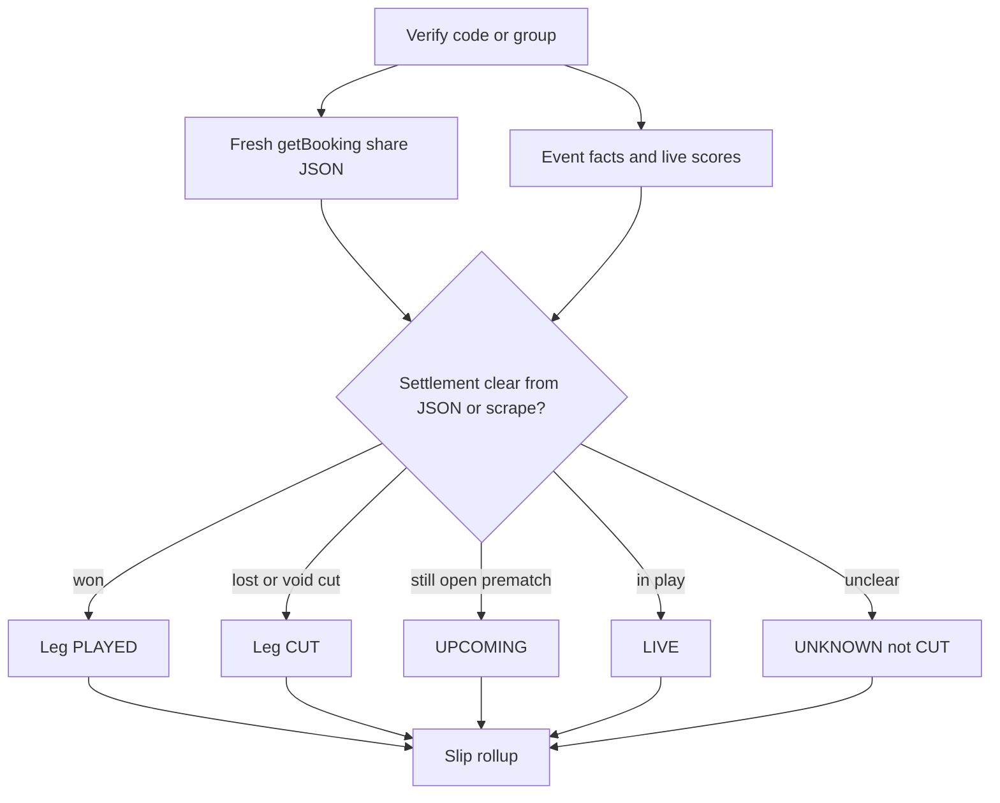

# Accurate game play verification

## Problem

[`PlayCheckService`](apps/api/src/groups/play-check.service.ts) marks a leg **CUT** when the share booking shows `unavailable` or `isActive === false`. In [`mapBookingOutcomes`](apps/api/src/bookmaker/sportybet.mapper.ts), `isActive` is forced off once `event.status !== '0'` (match started/finished):

```173:174:apps/api/src/bookmaker/sportybet.mapper.ts
isActive: !!outcome && mapOutcome(outcome).isActive
  && String(market?.status ?? '0') === '0' && String(event.status ?? '0') === '0',
```

So a **won, finished** pick often becomes CUT with a note like “lost / unavailable”. That is availability, not settlement.

Also: `PlayCheckService` is not registered in [`GroupsModule`](apps/api/src/groups/groups.module.ts); verify endpoints only call catalog ACTIVE checks today.

## Approach (chosen)

**Hybrid settlement verifier (no Playwright in production):**

1. **SportyBet share API** (existing `getBooking`) — keep for ticket presence and structure; stop using post-kickoff `isActive` as loss.
2. **Event facts** (`getFixtures` / live list) — finished/live/score for match state.
3. **Share-page HTML scrape** (fetch + parse) of `https://www.sportybet.com/{region}/?shareCode=CODE` — extract per-selection or ticket settled status when the JSON API does not expose won/lost clearly.

Browser automation (Playwright) is **not** the default runtime path: heavy on the VPS and brittle. If scrape + API still disagree, mark **UNKNOWN** (never false CUT) and log for manual/retry.



## Implementation

### 1. Separate bettability from settlement

In [`sportybet.mapper.ts`](apps/api/src/bookmaker/sportybet.mapper.ts):

- Keep `isActive` as “still open for betting” (current formula is OK for **booking creation**).
- Map any settlement-ish fields already present on share outcomes (e.g. outcome/event status strings) onto new optional fields on [`BookmakerSelection`](packages/shared/src/types.ts): `settlement?: 'WON' | 'LOST' | 'VOID' | 'PENDING' | 'UNKNOWN'`.

In [`play-check.service.ts`](apps/api/src/groups/play-check.service.ts):

- **Never** set CUT solely because `!active` after kickoff.
- Decision order:
  - Explicit settlement WON → `PLAYED`
  - Explicit settlement LOST / VOID → `CUT`
  - Prematch + still listed → `UPCOMING`
  - Live match → `LIVE`
  - Finished match + no settlement → `UNKNOWN` (or `PLAYED` only when scrape confirms win; do not invent loss)
- Soften play notes (remove “lost” unless settlement says LOST).

### 2. Share-page scrape fallback

Add `apps/api/src/bookmaker/sportybet.settlement.ts` (or under `groups/`):

- `fetchShareSettlement(code)` → HTTP GET share URL with the same client headers/rate limits as [`SportyBetClient`](apps/api/src/bookmaker/sportybet.client.ts).
- Parse JSON embedded in the page and/or visible selection status badges (won/lost/void/pending).
- Map to per-leg settlement keyed by `eventId+marketId+outcomeId(+specifier)`.
- Cache briefly in Redis (e.g. 60–120s) to avoid hammering SportyBet on history refreshes.

### 3. Wire into verify UX

- Register `PlayCheckService` in [`groups.module.ts`](apps/api/src/groups/groups.module.ts) (needs `CatalogModule` / `BookmakerModule`).
- Extend `GroupsService.verifyGroup` / `verifyCode` to run play-check after catalog validate, persist `playStatus` / `playNote` / `score` / `cutSummary`, and return them on group/code GET payloads so [`CutCallout`](apps/web/src/components/CutCallout.tsx) only shows real cuts.
- Ensure Prisma fields already on schema are selected in group/slip serializers.

### 4. Tests

- Unit tests for the new decision tree: finished+won → PLAYED; finished+lost → CUT; finished+inactive-only → UNKNOWN (not CUT); prematch unavailable → CUT.
- Mapper fixtures for share JSON with settled statuses if we discover real field names during implementation (capture one real share response sample in a test fixture, redact PII).

### 5. Docs

- Update [`docs/features/collections.md`](docs/features/collections.md) (or add `docs/features/play-verification.md`): CUT = lost/voided selection; UNKNOWN = could not confirm; verify uses share + scrape.

## Out of scope

- Playwright/Chromium in the API Docker image.
- Claiming 100% accuracy if SportyBet hides settlement — we prefer UNKNOWN over false CUT.
