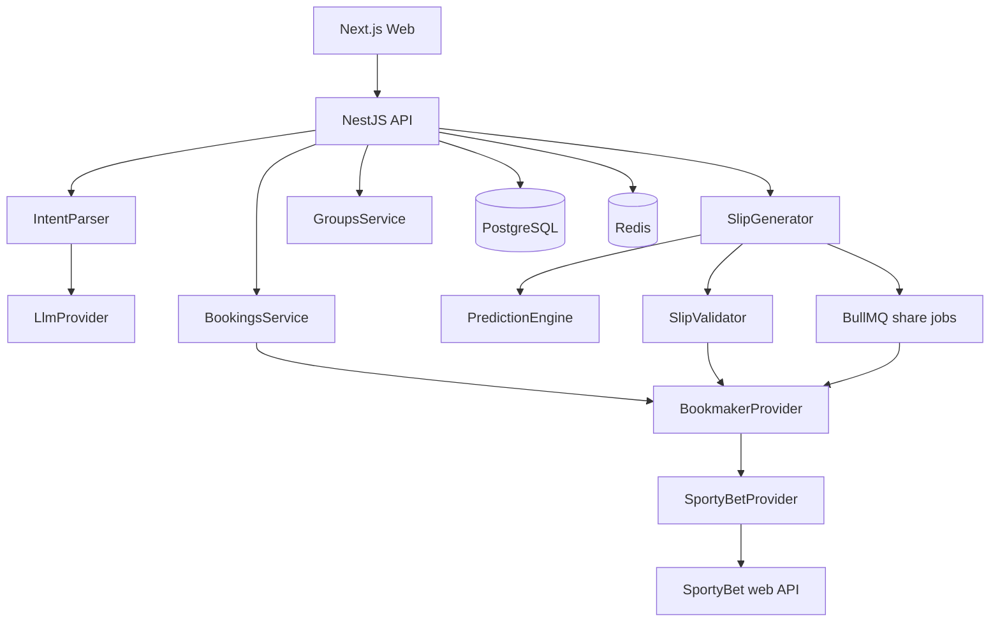

# myOdd MVP

## Product scope (locked)

- SportyBet Nigeria only, football, pre-match only
- No accounts, wallet, KYC, live betting, or staking
- Four pages: `/`, `/result/:id`, `/g/:id`, `/code/:code`
- 18+ / responsible gambling copy on every surface; never “safe” / “guaranteed” — use **Lower / Moderate / Higher variance**

## Odds-first prediction (what this means)

**No API-Football in V1.** Every selection score comes from SportyBet’s own live odds plus small market heuristics.

### Core idea

Bookmakers publish odds that already embed a probability estimate (plus margin). Convert odds → probability, strip the overround, then score how “attractive” a selection is relative to peers and market type.

```text
SportyBet odds  →  implied P  →  remove margin  →  market heuristics  →  score 0–100
```

Example for a 1X2 market:

| Outcome | Odds | Raw implied | After margin strip |
|---------|------|-------------|--------------------|
| Home 1.50 | 1.50 | 66.7% | ~62% |
| Draw 4.00 | 4.00 | 25.0% | ~23% |
| Away 6.00 | 6.00 | 16.7% | ~15% |
| **Sum** | | **108.4%** | **100%** |

### Scoring inputs (V1)

For each candidate selection:

1. **Fair probability** — odds inverse after normalizing the market overround
2. **Favourite strength** — higher fair-P favourites score higher for lower-variance modes
3. **Market-type bias** — double chance / Over 1.5 get a small boost for lower variance; long-shot moneyline gets a volatility penalty
4. **Odds stability proxy** — prefer actively listed, non-suspended outcomes (status from SportyBet)
5. **Leg diversity** — used later in slip scoring (correlation penalty), not in per-leg score

Final per-leg output:

```json
{
  "probability": 0.62,
  "confidence": 78,
  "modelVersion": "odds-v1"
}
```

### What odds-first does *not* know

Form, injuries, H2H, league table — those need API-Football later. V1 will still rank and diversify slips usefully because odds already reflect consensus, and the slip generator enforces odds bands, market filters, and fingerprints.

### Future swap path

```text
PredictionEngine (interface)
  ├── OddsImpliedEngine     ← V1 default
  └── ApiFootballEngine     ← later: form/stats + odds blend
```

Same `score(selection, context)` contract; no slip/generator changes when you add stats.

---

## Stack

| Layer | Choice |
|-------|--------|
| Monorepo | `pnpm` workspaces + Turborepo |
| Web | Next.js (App Router), TypeScript, Tailwind, TanStack Query |
| API | NestJS + TypeScript |
| DB | PostgreSQL + Prisma |
| Cache / queue | Redis + BullMQ (concurrency 2–4 for SportyBet share POSTs) |
| Prediction | TypeScript `OddsImpliedEngine` inside NestJS |
| Intent AI | Pluggable `LlmProvider` (OpenAI default; Anthropic/stub ready) |

Repo layout:

```text
apps/web          # Next.js
apps/api          # NestJS
packages/shared   # DTOs, market enums, risk labels, zod schemas
```

---

## Architecture



**Critical isolation:** nothing outside `SportyBetProvider` may call SportyBet URLs. Interface:

```ts
interface BookmakerProvider {
  getFixtures(query): Promise<Fixture[]>;
  getMarkets(eventId): Promise<Market[]>;
  getBooking(code): Promise<Booking>;
  createBooking(selections): Promise<CreatedBooking>;
}
```

Endpoints (from [Sportybet-mcp](https://github.com/UbongErnest/Sportybet-mcp)):

- `GET /api/ng/factsCenter/pcUpcomingEvents`
- `POST /api/ng/orders/share`
- `GET /api/ng/orders/share/{code}`

Client: 250ms min interval, max 4 concurrent, 90s fixture cache, never retry booking POST.

---

## Swappable LLM (intent only)

LLM **never** returns SportyBet IDs or picks. It only returns generation config.

```ts
interface LlmProvider {
  completeJson<T>(input: {
    system: string;
    user: string;
    schema: ZodSchema<T>;
  }): Promise<T>;
}
```

Implementations: `OpenAiProvider`, `AnthropicProvider`, `StubProvider` (deterministic rules for local/dev).

Config via env:

```text
LLM_PROVIDER=openai|anthropic|stub
OPENAI_API_KEY=...
OPENAI_MODEL=gpt-4o-mini
ANTHROPIC_API_KEY=...
ANTHROPIC_MODEL=claude-sonnet-4-5
```

NestJS factory injects the active provider. Changing model = change env, no code change.

Parsed config shape (`packages/shared`):

```json
{
  "numberOfSlips": 20,
  "minimumOdds": 3,
  "maximumOdds": 5,
  "maximumSelections": 8,
  "markets": ["DOUBLE_CHANCE", "OVER_1_5"],
  "riskPreference": "LOWER",
  "excludedTeams": [],
  "kickoffBefore": null
}
```

Fallback: if LLM fails, `RulesIntentParser` extracts numbers/markets/risk keywords from the instruction.

---

## Backend modules (`apps/api/src`)

- `bookmaker/` — interface + `SportyBetProvider` (client, mapper, rate limit)
- `bookings/` — `GET /api/bookings/:code`
- `ai/` — intent parser + LLM factory
- `predictions/` — `OddsImpliedEngine`
- `slips/` — analyze, generate, validate, fingerprint, score slips
- `groups/` — persist + public fetch
- `jobs/` — BullMQ workers for create-booking (concurrency 2–4)

### API

| Method | Path | Purpose |
|--------|------|---------|
| GET | `/api/bookings/:code` | Load original slip |
| POST | `/api/slips/analyze` | `{ bookingCode }` → original slip + preview scores |
| POST | `/api/slips/generate` | code + instruction → async job → group |
| POST | `/api/slips/generate-from-prompt` | instruction only |
| GET | `/api/groups/:groupId` | Public group + slips |
| GET | `/api/jobs/:jobId` | Progress for progressive UI |

Generate returns `{ jobId, groupId }` immediately; UI polls / uses SSE-lite polling while BullMQ creates codes.

---

## Slip generation pipeline

1. Load source: booking code legs **or** today’s SportyBet fixtures
2. Expand candidate pool (supported markets only): `1X`, `X2`, `12`, Home, Away, Over 1.5, Over 2.5, Under 3.5, BTTS Yes/No
3. Score with `OddsImpliedEngine`
4. Apply intent filters (markets, teams, kickoff, confidence floor by risk)
5. Build combinations targeting odds band; score slips:
   `avgConfidence - correlationPenalty - volatilityPenalty - excessiveLegPenalty`
6. Dedupe via SHA256 fingerprint of sorted `eventId|marketId|outcomeId|specifier`
7. Validate live (active event/market/outcome); replace unavailable legs
8. Queue SportyBet `orders/share` (concurrency 2–4)
9. Persist slips + group; bucket by variance label from odds/confidence

---

## Data model (Prisma)

- `slip_groups` — `id`, `public_id`, `title`, `description`, `created_at`, `expires_at`
- `generated_slips` — `group_id`, `booking_code`, `share_url`, `total_odds`, `confidence`, `risk_level`, `selection_count`, `fingerprint`, `expires_at`
- `slip_selections` — SportyBet IDs + display fields + odds + prediction fields + `kickoff_at`
- `predictions` — optional cache rows keyed by event/market/selection + `model_version`
- `generation_jobs` — status, progress, error for UI polling

No `users` table. Anonymous groups only.

Redis TTLs: fixtures 60–120s; predictions 5–30m; booking reads until `deadline`.

---

## Frontend pages (`apps/web`)

1. **`/`** — brand-first single composition: **myOdd**, one prompt (“What do you want to bet?”), code input **or** free-text instruction, Generate CTA, 18+ footer. No cards in hero.
2. **`/result/:id`** — original slip (if any), progressive fill of Lower / Moderate / Higher variance groups, Share all.
3. **`/g/:id`** — public share page (same content, social-friendly meta).
4. **`/code/:code`** — single slip detail + Copy / Open SportyBet / Share (WhatsApp, Telegram, X, Facebook, copy link).

Share text template includes platform, code, selections, odds, “Generated with myOdd”, **18+ | Gamble responsibly**. Public share URLs use the product host (e.g. `myodd.app/g/7DPQ2` — exact domain TBD).

---

## Implementation phases

**Phase 0 — Scaffold**  
Monorepo, Docker Compose (Postgres + Redis), Prisma schema, shared types, env examples.

**Phase 1 — SportyBet adapter**  
Read booking, list fixtures/markets, create share code, unit tests with fixtures, no-stake guard.

**Phase 2 — Odds engine + slip generator**  
Scoring, combinations, fingerprints, validation/replace, BullMQ booking jobs.

**Phase 3 — Intent layer**  
`LlmProvider` + OpenAI impl + stub/rules fallback; wire generate endpoints.

**Phase 4 — Web UI**  
Four pages, progressive job polling, share links, responsible-gambling chrome.

**Phase 5 — Hardening**  
Rate limits on our API, expiry cleanup, error UX when SportyBet rejects legs, README with adapter risk note.

---

## Env (minimum)

```text
DATABASE_URL=
REDIS_URL=
LLM_PROVIDER=openai
OPENAI_API_KEY=
OPENAI_MODEL=gpt-4o-mini
SPORTYBET_REGION=ng
SPORTYBET_MAX_CONCURRENCY=4
```

No SportyBet credentials required.

---

## Explicit non-goals (V1)

API-Football, multi-bookmaker UI, accounts, RAG/vector DB, Python ML, live markets, correct score / props / corners, admin dashboard, mobile app.
